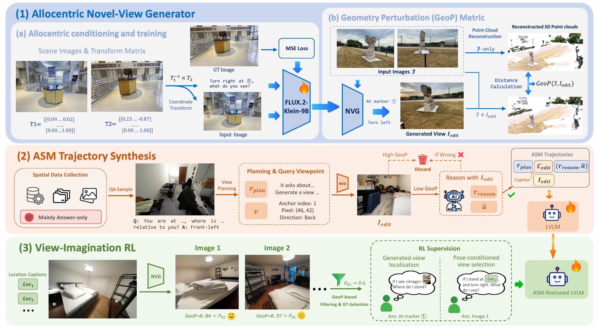
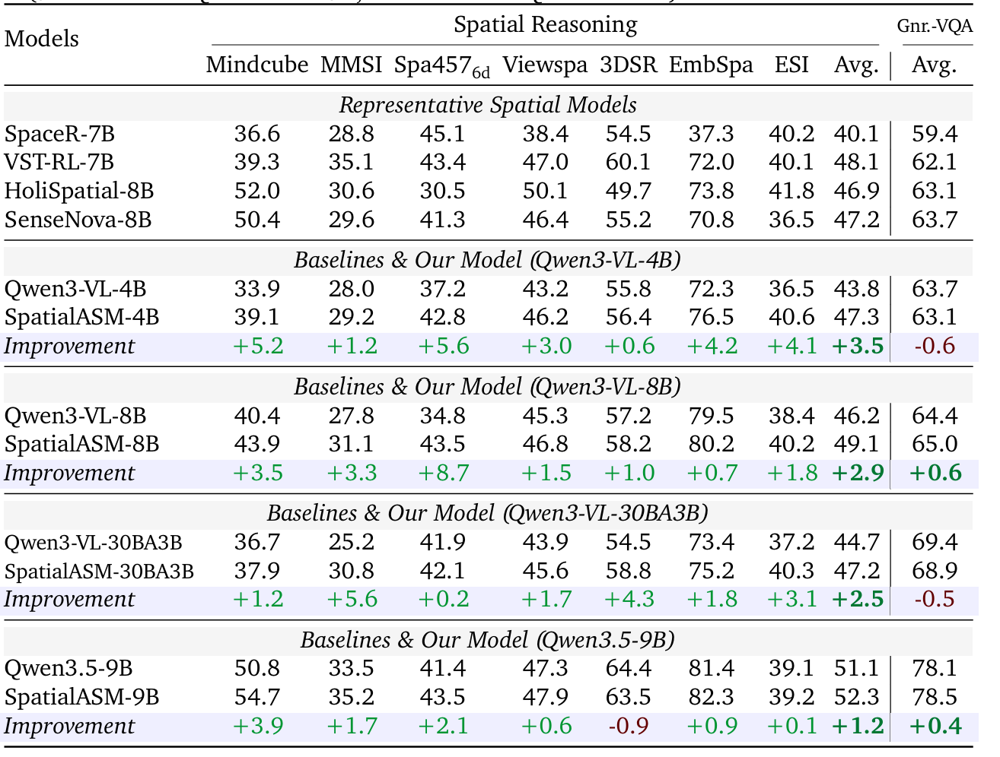
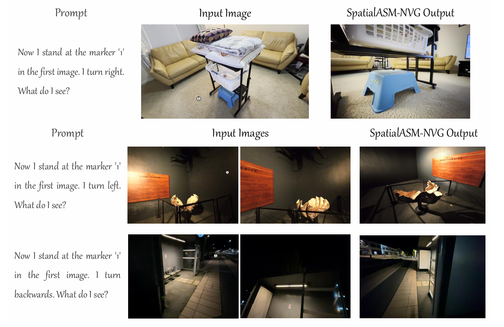
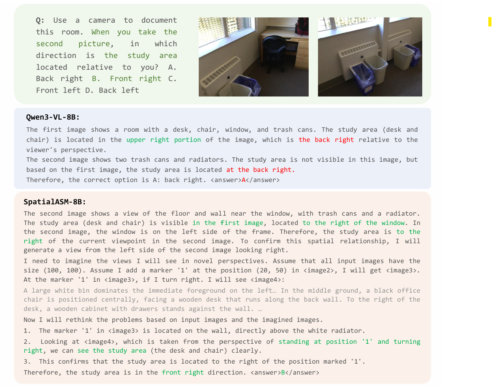

<div align="center">
  <h1 align="center">SpatialASM: Internalizing Active Mentalization for Spatial Reasoning</h1>

  <p align="center">
    <a href="https://scholar.google.com/citations?hl=en&user=yQ8U3tUAAAAJ"><strong>Yuhong Liu<sup>*</sup></strong></a >
    ·
    <a href="https://scholar.google.com/citations?hl=en&user=AC1sE1kAAAAJ"><strong>Shenxi Wu<sup>*</sup></strong></a >
    ·
    <a href="https://github.com/JunyiChi/"><strong>Junyi Chi</strong></a >
    .
    <a href="https://beichenzbc.github.io/"><strong>Beichen Zhang</strong></a >
    </br>
    <a href="https://lennoxdai.github.io/LennoxDai/"><strong>Xuanlang Dai</strong></a >
    ·
     <a href="https://myownskyw7.github.io/"><strong>Jiaqi Wang<sup>&dagger;</sup></strong></a >
    .
    <a href="https://yuhangzang.github.io/"><strong>Yuhang Zang<sup>&dagger;</sup></strong></a >
    ·
    <a href="http://dahua.site/"><strong>Dahua Lin<sup>&dagger;</sup></strong></a >    
  </p >
  <p align="center">
    <sup>*</sup>Equal contribution. &nbsp;&nbsp; <sup>&dagger;</sup>Corresponding authors.
  </p>
  <p align="center" style="font-size: 1.2em; margin-top: 0.5em">
    📖<a href="http://arxiv.org/abs/2610.13832">Paper</a>
  | 🏠<a href="https://github.com/InternLM/SpatialASM">Homepage</a >
  | 🤗<a href="https://huggingface.co/collections/YuhongLiu/spatialasm">SpatialASM Collection</a >
  | 🤗<a href="https://huggingface.co/datasets/YuhongLiu/SpatialASM-128k">SpatialASM-128k Dataset</a >
  | 🤗<a href="https://huggingface.co/YuhongLiu/SpatialASM-NVG">SpatialASM-NVG Model</a >
  </p > 
</div>

## 📢 News
- 🚀 [2026/10/12] We have released the SpatialASM [📖Arxiv paper](https://arxiv.org/abs/2610.13832) and its [repository](https://github.com/InternLM/SpatialASM).
- 🚀 [2025/10/12] We have released our allocentric novel-view generator [🤗SpatialASM-NVG](https://huggingface.co/YuhongLiu/SpatialASM-NVG).
- 🚀 [2025/10/12] We have released [🤗SpatialASM-edit140k](https://huggingface.co/datasets/YuhongLiu/SpatialASM-edit140k), an image-text-to-image dataset for tuning novel-view generators, and two spatial-VQA datasets with high-quality CoT responses: [🤗SpatialASM-128k](https://huggingface.co/datasets/YuhongLiu/SpatialASM-128k) and its subset [🤗SpatialASM-66k](https://huggingface.co/datasets/YuhongLiu/SpatialASM-66k).

## 🌈 Overview

Humans rarely solve difficult spatial problems by passively inspecting the views in front of them. Instead, we revisit a scene from task-relevant viewpoints and mentally reconstruct what should be visible there. We call this capability **Active Spatial Mentalization (ASM)**.

We are thrilled to introduce **SpatialASM**, a scalable framework that internalizes ASM into LVLMs. Through the two-stage training on LVLMs, SpatialASM elicits active spatial exploration and imagination and enhances the overall spatial reasoning performance.
<p style="text-align: center;"> 
   
</p>

SpatialASM consists of three complementary components:

1. **Allocentric Novel-View Generator.** SpatialASM-NVG renders the scene from a target viewpoint specified by an anchor image, a pixel location, and a viewing direction. This allocentric formulation avoids lengthy sequences of camera-centric movements.
2. **ASM Trajectory Synthesis.** Given a spatial QA sample, an LVLM plans informative viewpoints and the NVG renders the corresponding observations. After GeoP and answer-consistency filtering, rendered views are replaced by textual captions to form explicit plan-imagine-reason trajectories for SFT.
3. **View-Imagination Reinforcement Learning.** Geometry-filtered candidate views are used to construct automatically verifiable perspective-taking tasks. GRPO further strengthens the association between a viewpoint description and its expected observation.
<p style="text-align: center;"> 
   
</p>


## 💡 Highlights

- 🔥 **Active spatial reasoning:** SpatialASM jointly internalizes task-conditioned **view planning** and viewpoint-conditioned **view imagination**, enabling LVLMs to spontaneously seek and mentally construct missing spatial evidence.
- 🔥 **Scalable spatial CoT supervision:** SpatialASM converts existing answer-only spatial QA data into explicit plan-imagine-reason trajectories and automatically verifiable perspective-taking tasks, alleviating the scarcity of spatial Chain-of-Thought supervision.
- 🔥 **Training-time spatial simulation:** A novel-view generator acts as temporary training scaffolding. The final model does not depend on a world model, renderer, or additional visual observations at inference time.
- 🔥 **Grounded and reliable supervision:** An allocentric viewpoint interface reaches a target perspective in one query, while the **Geometry Perturbation (GeoP)** metric and answer-consistency checks filter unreliable synthesized views and trajectories.
<p style="text-align: center;"> 
   
</p>


## 📊 Results

We train four LVLM backbones of Qwen3-VL and Qwen3.5 with our SpatialASM framework, and the experimental results on both spatial reasoning and general-VQA tasks are shown below.

<p style="text-align: center;"> 
   
</p>


## ⭐️ Quick Start
Here we provide some simple inference code for you to try our models. The models include the LVLMs such as [🤗SpatialASM-Qwen3-VL-4B](https://huggingface.co/YuhongLiu/SpatialASM-Qwen3-VL-4B) (see **📢News** above), and the novel-view generator [🤗SpatialASM-NVG](https://huggingface.co/YuhongLiu/SpatialASM-NVG).

To use the LVLMs, you can either start a [vLLM](https://github.com/vllm-project/vllm) server or load it in your device with [Transformers](https://github.com/huggingface/transformers). 
```bash
# Start a vLLM server for fine-tuned LVLMs.
git clone https://github.com/InternLM/SpatialASM.git
cd SpatialASM
conda create -n spatialasm_vllm python==3.11
conda activate spatialasm_vllm
pip install -r Inference/vllm_server_requirements.txt # [spatialasm_vllm] Environment Preparation
bash Inference/vllm_server.sh \
  "vllm--spatialasm-qwen3.5-9b" \
  "YuhongLiu/SpatialASM-Qwen3.5-9B" \ # Your local path
  "23333" \
  "0"

# SpatialASM-NVG Inference 
conda create -n NVG python==3.11
conda activate NVG
cd DiffSynth-Studio && pip install -e . # [NVG] Environment Preparation
cd ..
bash Inference/edit_server.sh
python3 Inference/check_NVG.py # Change the input image paths in check_NVG.py first.
```


## 🛠️ Training
First download <a href="https://huggingface.co/black-forest-labs/FLUX.2-klein-9B">FLUX.2-klein-9B</a > and [SpatialASM-edit140k](https://huggingface.co/datasets/YuhongLiu/SpatialASM-edit140k). Then convert the dataset to the format in <a href="https://github.com/InternLM/SpatialASM/blob/main/DiffSynth-Studio/training-scripts/training_samples.jsonl">training_samples.jsonl</a >, and change paths in <a href="https://github.com/InternLM/SpatialASM/blob/main/DiffSynth-Studio/training-scripts/NVG-training.sh">NVG-training.sh</a > to your local path. And you can start training!
```bash
conda activate NVG # First prepare the environment NVG. (see `⭐️Quick Start')
cd DiffSynth-Studio
bash training-scripts/NVG-training.sh
```

- 🔥 The training code for LVLMs will be coming soon.

## 🛠️ Evaluation
Prepare the environment:
```bash
conda create -n evaluation python==3.10
conda activate evaluation
cd Evaluation/VLMEvalKit
pip install -e .

# Recommended
pip install flash-attn --no-build-isolation
```
All benchmarks except ESI-Bench are supported by <a href="https://github.com/open-compass/VLMEvalKit">VLMEvalkit</a >. We use its official repository. 
```bash
# Single GPU
python3 run.py --data <dataset_name> --model SpatialASM-Qwen3-VL-8B --verbose

# Multi-GPU (Distributed)
torchrun --nproc-per-node=8 run.py --data <dataset_name> --model SpatialASM-Qwen3-VL-8B --verbose

# For SpatialASM-Qwen3.5-9B, it's recommended to first start a vLLM server for evaluation
bash qwen3_5_api.sh
```
- 🔥 The evaluation code for ESI-passive will be released soon.

## 🧩Cases
<p style="text-align: center;"> 
   
</p>
<p style="text-align: center;"> 
   
</p>

## ✒️Citation
If you find this project useful, please kindly cite:
```
@article{liu2026spatialasm,
  title={SpatialASM: Internalizing Active Mentalization for Spatial Reasoning},
  author={Yuhong Liu, Shenxi Wu, Junyi Chi, Beichen Zhang, Xuanlang Dai, Jiaqi Wang, Yuhang Zang, Dahua Lin},
  journal={arXiv preprint arXiv:2610.13832},
  year={2026}
}
```

## 📄 License
  

**Use of SpatialASM-NVG**: The model <a href="https://huggingface.co/YuhongLiu/SpatialASM-NVG">SpatialASM-NVG</a > is trained on <a href="https://huggingface.co/black-forest-labs/FLUX.2-klein-9B">FLUX.2-klein-9B</a >, so please follow <a href="https://github.com/black-forest-labs/flux2/blob/main/model_licenses/LICENSE-FLUX-NON-COMMERICAL">FLUX-NON-COMMERCIAL LICENSE</a >.

**Usage and License Notices**: The data and code are intended and licensed for research use only.

## ❤️ Acknowledgement
The evaluation part is built on <a href="https://github.com/open-compass/VLMEvalKit">VLMEvalkit</a >, a powerful toolkit to evaluate a vast range of LMMs!

The NVG training part is built on <a href="https://github.com/modelscope/DiffSynth-Studio">DiffSynth-Studio</a >, an excellent codebase for Diffusion model training!
